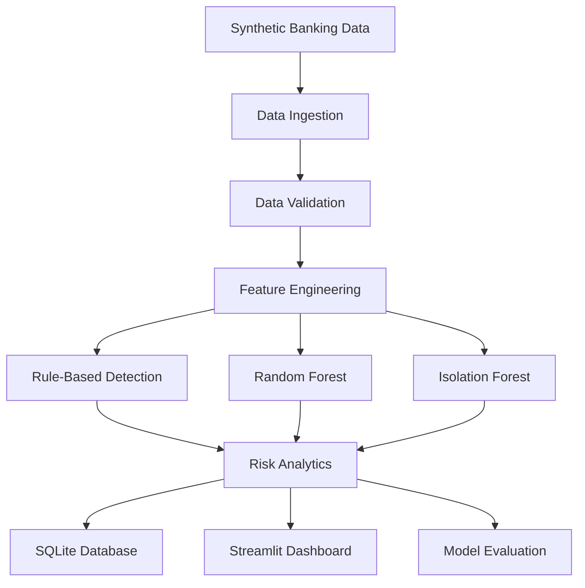
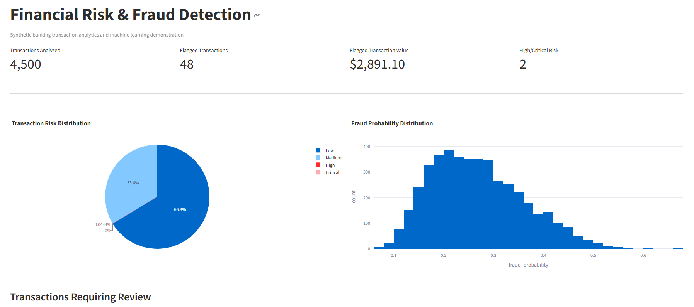
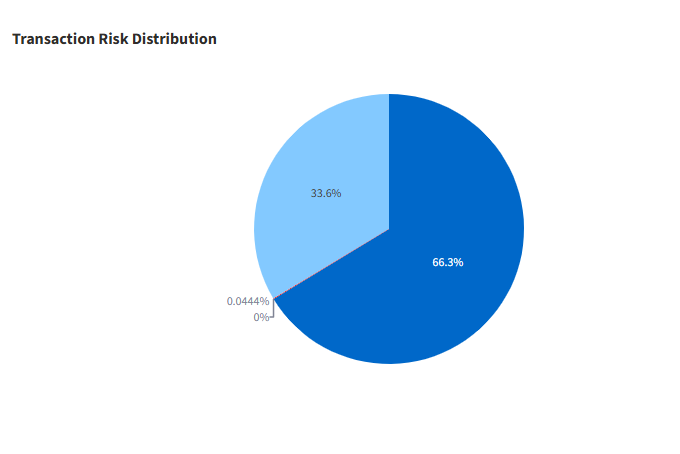
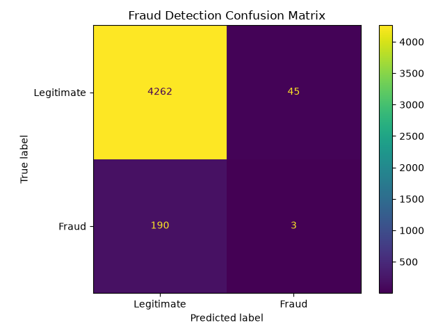
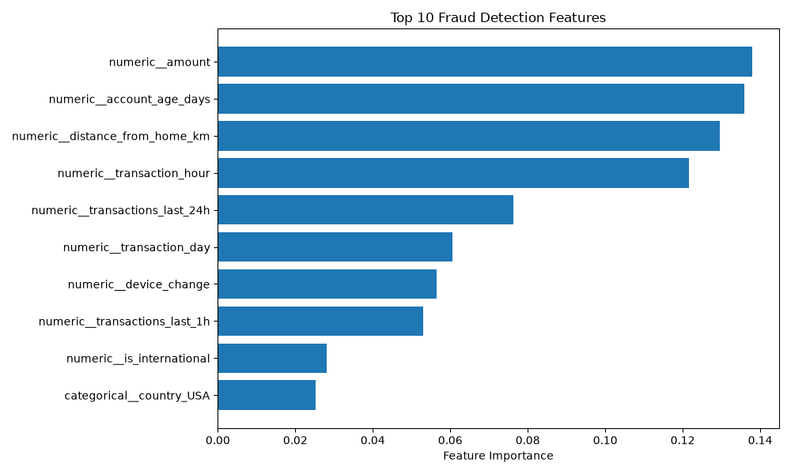

# python-finance-fraud-analytics
Python finance project


# Financial Risk & Fraud Detection Platform


## 1. Project Overview

An end-to-end Python-based financial analytics and fraud
detection platform designed to identify suspicious banking
transactions, evaluate financial risk, and generate
actionable analytics.

The solution demonstrates Python engineering, data
processing, feature engineering, machine learning,
anomaly detection, and financial analytics.

All transaction data is synthetic and generated for
demonstration purposes.

## 2. Business Objectives

- Identify potentially fraudulent transactions.
- Detect unusual transaction behavior.
- Calculate financial transaction risk scores.
- Evaluate machine learning performance.
- Analyze potential financial exposure.
- Provide interactive fraud monitoring analytics.

## 3. Technology Stack

- Python
- Pandas
- NumPy
- Scikit-learn
- Matplotlib
- Seaborn
- Plotly
- Streamlit
- SQLAlchemy
- SQLite
- Pytest
- Git / GitHub

## 4. Architecture



## 5. Project Structure

```text
data/
models/
notebooks/
reports/
src/
    data/
    features/
    models/
    analytics/
    database/
tests/
docs/
app.py
requirements.txt
README.md
```

## 6. Machine Learning Approach

### Supervised Learning

Random Forest classification using historical
transaction labels.

### Unsupervised Learning

Isolation Forest for identifying anomalous
transaction behavior.

### Rule-Based Detection

Business rules for identifying suspicious
transaction patterns.

## 7. Model Evaluation

Evaluation includes:

- Precision
- Recall
- F1 Score
- ROC-AUC
- Average Precision
- Confusion Matrix
- Precision-Recall Curve

See [Model Results](docs/model-results.md).

## 8. Application Screenshots

### Financial Risk Dashboard



### Fraud Risk Distribution



### Model Evaluation



### Feature Importance



## 9. How to Run the Project

### Clone repository

```bash
git clone https://github.com/jdtechproj/python-finance-fraud-analytics.git

cd python-finance-fraud-analytics
```

### Create virtual environment

```bash
python -m venv .venv
```

### Activate environment

Windows PowerShell:

```powershell
.venv\Scripts\Activate.ps1
```

### Install dependencies

```bash
pip install -r requirements.txt
```

### Generate transaction data

```bash
python -m src.data.generate_data
```

### Validate data

```bash
python -m src.data.validate_data
```

### Train fraud detection model

```bash
python -m src.models.train_model
```

### Run anomaly detection

```bash
python -m src.models.anomaly_detection
```

### Generate evaluation results

```bash
python -m src.models.evaluate_model
```

### Launch dashboard

```bash
streamlit run app.py
```

## 10. Testing

Run automated tests:

```bash
pytest -v
```

## 11. Data Disclaimer

This project uses synthetic banking transactions.
It does not contain real customer or financial
institution information.

Model outputs are illustrative and are not intended
for actual financial fraud decisions.

## 12. Future Enhancements

- Real-time transaction scoring API.
- Advanced fraud detection algorithms.
- SHAP-based model explainability.
- Model drift monitoring.
- CI/CD automation.
- Cloud-based deployment.
- Integration with Snowflake.

## 13. Author

Data Engineering and Analytics Portfolio

GitHub: jdtechproj
